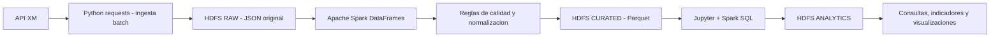

# PROYECTO FINAL XM - Infraestructura Big Data para analisis de recurso hidrico

Proyecto academico del curso **Gestion de Datos Masivos** orientado a construir una infraestructura reproducible para ingerir, almacenar, procesar y consultar informacion publica de XM relacionada con recurso hidrico, generacion electrica y precio de bolsa en Colombia.

## 1. Objetivo

Construir un pipeline reproducible que permita seguir el dato desde la API de XM hasta resultados analiticos verificables, utilizando almacenamiento distribuido en HDFS y procesamiento con Apache Spark.

El foco analitico es el **recurso hidrico**. La generacion y el precio de bolsa se utilizan como contexto para estudiar como se comportan estas variables durante diferentes condiciones hidricas. Las asociaciones observadas no se interpretan automaticamente como causalidad.

## 2. Preguntas priorizadas

1. **Calidad y trazabilidad:** ¿Que porcentaje de registros presenta problemas de completitud, duplicidad, fechas invalidas o integridad referencial, y en que fuente o periodo se concentran?
2. **Embalses:** ¿Que embalses presentan menor almacenamiento relativo respecto a su capacidad util y como cambia esta condicion en el tiempo?
3. **Aportes hidricos:** ¿Que rios presentan aportes por debajo de su media historica y durante cuanto tiempo se mantiene esta condicion?
4. **Hidrologia y generacion:** ¿Como cambia la generacion hidroelectrica entre periodos con diferentes condiciones hidricas?
5. **Hidrologia y precio:** ¿Como se comporta el precio de bolsa durante periodos con diferentes condiciones hidricas?

## 3. Arquitectura



### Responsabilidad de cada componente

- **Docker Compose:** reproduce la infraestructura del proyecto.
- **HDFS:** almacena los datos distribuidos en zonas RAW, CURATED, ANALYTICS y QUALITY.
- **Python/requests:** realiza la ingesta batch desde la API de XM.
- **Spark:** normaliza, valida, transforma, cruza y agrega los datos.
- **Parquet:** formato utilizado para datos curados por su lectura columnar y compatibilidad con Spark.
- **JupyterLab:** espacio interactivo para explorar, ejecutar Spark SQL y documentar las consultas finales.
- **Kafka:** se mantiene disponible en la infraestructura, pero no forma parte del flujo batch principal mientras no exista una justificacion de streaming.
- **Git/GitHub:** versiona codigo, configuracion y documentacion. Los datasets masivos permanecen en HDFS y no se suben al repositorio.

## 4. Zonas de datos en HDFS

```text
/proyecto_xm/raw
/proyecto_xm/curated
/proyecto_xm/analytics
/proyecto_xm/quality/rejected
/proyecto_xm/quality/corrected
```

Equivalencia conceptual con arquitectura medallon:

```text
RAW       ~= Bronze
CURATED   ~= Silver
ANALYTICS ~= Gold
```

## 5. Fuentes y metricas actuales

### API historica XM

Periodo configurado del proyecto: **2020-01-01 a 2026-11-19**.

Metricas diarias:

- `PorcVoluUtilDiar` - Embalse
- `VoluUtilDiarMasa` - Embalse
- `CapaUtilDiarMasa` - Embalse
- `AporCaudal` - Rio
- `AporCaudalMediHist` - Rio
- `PorcApor` - Rio

Metricas horarias:

- `Gene` - Recurso
- `PrecBolsNaci` - Sistema

Catalogos XM:

- `ListadoEmbalses`
- `ListadoRios`
- `ListadoRecursos`

> **Pendiente de rubrica:** incorporar y documentar una segunda fuente de **tipo distinto**. Los catalogos de XM complementan la API historica, pero no se consideran por si solos una segunda fuente externa independiente.

## 6. Volumen procesado

Para `Gene` se validaron:

- Archivos JSON RAW: **89**
- Items API: **662.600**
- Posiciones horarias normalizadas: **15.902.400**
- Eventos horarios con valor valido: **12.296.013**
- Posiciones sin valor: **3.606.387**

El volumen de eventos validos de `Gene` supera el minimo de 250.000 eventos requerido por el proyecto.

> La prueba formal de escalamiento y la estrategia 10x se encuentran pendientes de ejecutar y documentar.

## 7. Calidad de datos

El pipeline RAW -> CURATED implementa cuatro reglas principales:

- `R1_COMPLETITUD`: fecha, entidad o valor ausente/vacio.
- `R2_INTEGRIDAD_NUMERICA`: valor presente que no puede convertirse a numero.
- `R3_RANGO`: fecha fuera del periodo configurado o, para datos horarios, hora fuera del rango 1-24.
- `R4_DUPLICADO`: duplicidad de la clave logica de la observacion.

En `Gene`, los **3.606.387** registros rechazados se clasificaron actualmente por `R1_COMPLETITUD`. Esto describe posiciones horarias sin valor; no demuestra por si solo la causa del faltante.

La integridad referencial se evaluo adicionalmente al comparar los codigos de `Gene` con `ListadoRecursos`.

## 8. Catalogo de recursos y enriquecimiento de Gene

El catalogo RAW de recursos contiene:

- **2.522 registros**
- **2.519 codigos unicos**
- **3 codigos duplicados**
- **1 codigo con conflicto de nombre**

Se creo una version CURATED con una sola fila por codigo y se conservaron indicadores de duplicidad/conflicto para no corregir silenciosamente la fuente.

Al comparar con `Gene`:

- Recursos distintos en `Gene`: **672**
- Recursos encontrados en el catalogo actual: **647**
- Recursos no encontrados: **25**
- Recursos hidraulicos presentes en `Gene`: **160**

El enriquecimiento se realizo mediante `LEFT JOIN` para conservar todos los eventos historicos. Resultado:

- Filas antes del JOIN: **12.296.013**
- Filas despues del JOIN: **12.296.013**
- Eventos sin correspondencia con catalogo: **112.246**
- Recursos sin correspondencia: **25**
- Eventos clasificados como hidraulicos: **7.277.050**
- Recursos hidraulicos: **160**

La igualdad del numero de filas antes y despues del JOIN valida que el cruce no multiplico registros.

### Limitacion del catalogo

`ListadoRecursos` fue descargado como una fotografia vigente del catalogo, mientras `Gene` contiene historia desde 2020. Por tanto, la ausencia de 25 codigos en el catalogo actual se registra como una limitacion de integridad referencial y no como evidencia suficiente de error en los datos historicos.

## 9. Estructura esperada del repositorio

```text
PROYECTO_FINAL_XM/
├── README.md
├── compose.yaml
├── Dockerfile.spark-client
├── config/
├── data/
├── ingestion/
│   └── ingesta_xm.py
├── spark/
│   ├── 01_contar_eventos_gene.py
│   ├── 02_raw_a_curated.py
│   ├── 03_resumen_calidad_gene.py
│   ├── 04_concentracion_faltantes_gene.py
│   ├── 05_validar_catalogo_recursos.py
│   ├── 06_revisar_duplicados_catalogo.py
│   ├── 07_curar_catalogo_recursos.py
│   └── 08_enriquecer_gene_recursos.py
├── sql/
├── notebooks/
├── tests/
├── docs/
└── evidence/
```

## 10. Requisitos del host

- Docker Desktop o Docker Engine con Docker Compose.
- Git.
- Navegador web para JupyterLab, HDFS y Spark UI.
- Recursos suficientes para ejecutar NameNode, dos DataNodes, Spark Master, dos Spark Workers, Spark Client/Jupyter y Kafka.

No se requiere instalar Spark ni Hadoop directamente en el host; se ejecutan dentro de contenedores.

## 11. Clonar o actualizar el repositorio

Primera ejecucion:

```bash
git clone https://github.com/santiagohenao569-star/PROYECTO_FINAL_XM.git
cd PROYECTO_FINAL_XM
```

Si el repositorio ya existe:

```bash
git status
git pull origin main
```

Se recomienda actualizar solo cuando el arbol de trabajo este limpio o despues de guardar correctamente los cambios propios.

## 12. Levantar la infraestructura

```bash
docker compose up -d --build
```

Verificar:

```bash
docker compose ps
```

Servicios principales del proyecto:

```text
xm-namenode
xm-datanode1
xm-datanode2
xm-spark-master
xm-spark-worker1
xm-spark-worker2
xm-kafka
xm-spark-client
```

## 13. Ingesta batch

Solo si HDFS no contiene los datos requeridos:

```bash
docker exec xm-spark-client python3 /opt/gdm/ingestion/ingesta_xm.py
```

La ingesta guarda los JSON originales bajo:

```text
/proyecto_xm/raw/xm
```

El proceso utiliza ventanas temporales para consultar el historico y contempla reintentos y omision de archivos ya existentes como apoyo a la reejecucion.

## 14. Pipeline Spark

### 14.1 Conteo de eventos Gene

```bash
docker exec xm-spark-client /opt/spark/bin/spark-submit \
  --master spark://spark-master:7077 \
  /opt/gdm/spark/01_contar_eventos_gene.py
```

### 14.2 RAW -> CURATED y calidad

```bash
docker exec xm-spark-client /opt/spark/bin/spark-submit \
  --master spark://spark-master:7077 \
  /opt/gdm/spark/02_raw_a_curated.py
```

### 14.3 Resumen de calidad Gene

```bash
docker exec xm-spark-client /opt/spark/bin/spark-submit \
  --master spark://spark-master:7077 \
  /opt/gdm/spark/03_resumen_calidad_gene.py
```

### 14.4 Concentracion de faltantes

```bash
docker exec xm-spark-client /opt/spark/bin/spark-submit \
  --master spark://spark-master:7077 \
  /opt/gdm/spark/04_concentracion_faltantes_gene.py
```

### 14.5 Integridad con catalogo de recursos

```bash
docker exec xm-spark-client /opt/spark/bin/spark-submit \
  --master spark://spark-master:7077 \
  /opt/gdm/spark/05_validar_catalogo_recursos.py
```

### 14.6 Revision de duplicados del catalogo

```bash
docker exec xm-spark-client /opt/spark/bin/spark-submit \
  --master spark://spark-master:7077 \
  /opt/gdm/spark/06_revisar_duplicados_catalogo.py
```

### 14.7 Curacion del catalogo de recursos

```bash
docker exec xm-spark-client /opt/spark/bin/spark-submit \
  --master spark://spark-master:7077 \
  /opt/gdm/spark/07_curar_catalogo_recursos.py
```

### 14.8 Enriquecimiento de Gene

```bash
docker exec xm-spark-client /opt/spark/bin/spark-submit \
  --master spark://spark-master:7077 \
  /opt/gdm/spark/08_enriquecer_gene_recursos.py
```

Resultado:

```text
/proyecto_xm/curated/generacion_enriquecida
```

## 15. Jupyter y consultas

Abrir:

```text
http://localhost:8888
```

Jupyter no almacena los datos. Los notebooks leen los Parquet directamente desde HDFS mediante Spark.

Ejemplo:

```python
from pyspark.sql import SparkSession

spark = (
    SparkSession.builder
    .appName("AnalisisXM")
    .master("spark://spark-master:7077")
    .getOrCreate()
)

generacion = spark.read.parquet(
    "hdfs://namenode:9000/proyecto_xm/curated/generacion_enriquecida"
)

generacion.createOrReplaceTempView("generacion")
```

Las cinco consultas finales y sus salidas ANALYTICS se implementaran y documentaran en esta etapa.

## 16. Interfaces

Puertos exactos deben validarse con el `compose.yaml` versionado. Interfaces previstas:

- JupyterLab: `http://localhost:8888`
- HDFS NameNode UI: `http://localhost:9870`
- Spark Master UI: `http://localhost:8080`
- Spark Worker 1: `http://localhost:8081`
- Spark Worker 2: `http://localhost:8082`
- Spark Application UI: `http://localhost:4040` cuando exista una aplicacion Spark activa desde el cliente.

## 17. Apagado seguro

Para detener la infraestructura conservando los volumenes:

```bash
docker compose down
```

**No ejecutar durante el proyecto:**

```bash
docker compose down -v
```

La opcion `-v` elimina volumenes y puede borrar los datos almacenados por HDFS.

## 18. Estado actual frente al proyecto final

### Completado

- Infraestructura reproducible con Docker Compose.
- HDFS con NameNode y dos DataNodes.
- Spark Master y dos Workers.
- Ingesta batch de XM.
- Zonas RAW y CURATED.
- Volumen superior a 250.000 eventos.
- Normalizacion de 8 metricas.
- Cuatro reglas de calidad.
- Registros rechazados separados.
- Catalogo de recursos curado.
- Integridad referencial evaluada.
- Enriquecimiento de Gene sin multiplicacion de filas.
- Versionamiento en Git/GitHub.

### Pendiente

- Segunda fuente de tipo distinto.
- Materializar resultados finales en ANALYTICS.
- Cinco consultas finales completas.
- Validacion con subconjunto controlado y resultado conocido.
- Prueba de escalamiento con al menos dos volumenes y estrategia 10x.
- Medicion formal de tiempos, particiones y shuffle.
- Prueba formal de reinicio/idempotencia/recuperacion.
- Informe final y presentacion de defensa.

## 19. Uso de herramientas generativas

El proyecto ha utilizado asistencia generativa como apoyo para estructurar documentacion, explicar conceptos, revisar codigo y proponer procedimientos de validacion. El equipo debe verificar los comandos y resultados en su propio entorno y cada integrante debe poder explicar y defender el codigo y las decisiones entregadas.
